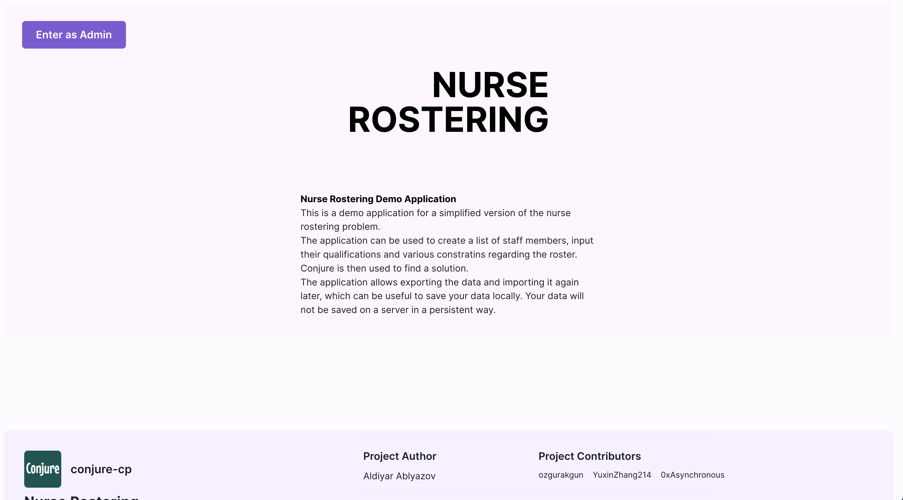
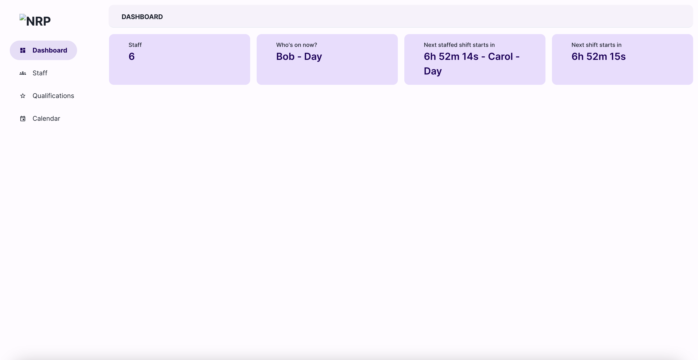
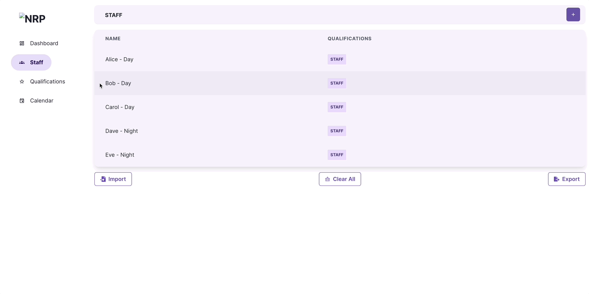
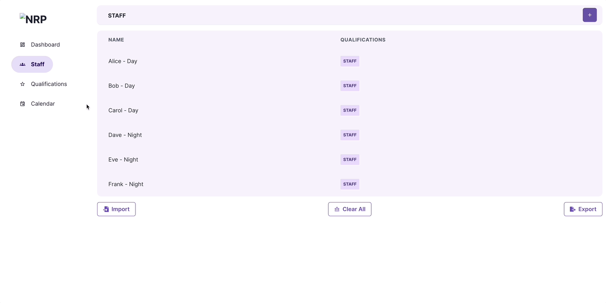
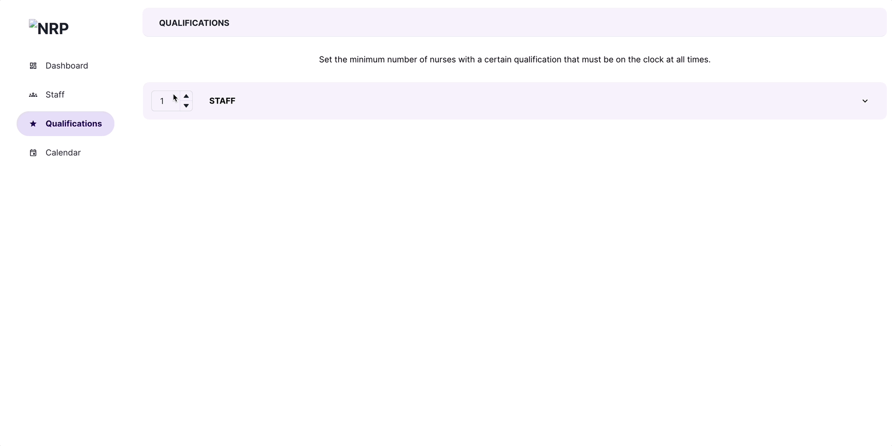

## Getting Started

First, install the dependencies:

```bash
yarn install
#or
npm install
```

Then, run the development server:

```bash
yarn dev
# or
npm run dev
```

Open [http://localhost:3000](http://localhost:3000) with your browser to see the result.


## User Interface

Below are some screenshots of the project UI:

### Home Page



This is the **homepage**

### Dashboard



This is the dashboard showing the scheduling

## Example Screenshots

### Create staff



Create staff **Frank**, who preferred night shifts

### Set qualification



Set the at least **1 staff** that must be on the clock at all times.

### Schedule



Schedule and get the timetable

## Generated asset comparison

Pull requests build the base and head revisions in the same environment and
compare every generated HTML, JavaScript (`.js`, `.mjs`, `.cjs`), and CSS file in
`out/`. The check fails on any byte or filename difference, including asset
hashes; nothing is normalized. Changed files appear in the job summary, and the
`generated-assets-diff` artifact contains the recursive diff. Intentional output
changes therefore also fail this comparison and need review.

For this CI job only, both revisions use the same Next.js build ID through
`generateBuildId` before compilation. This removes random build inputs without
rewriting or filtering the generated files. Deployment builds keep their normal
build IDs.

## License

This project is licensed under the Mozilla Public License 2.0. For full license information, please see the [LICENSE](./LICENSE) file in the repository.